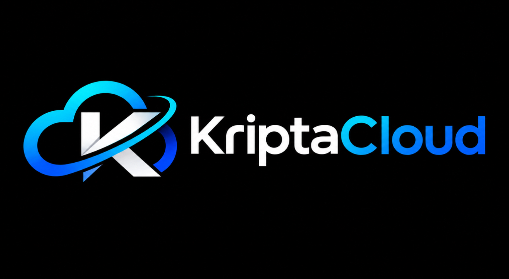

<div align="center">
  
</div>

# Kripta Cloud

Landing page oficial de apresentação da **Kripta Cloud** ([kriptacloud.com](https://kriptacloud.com)) — plataforma de armazenamento na nuvem com encriptação ponta-a-ponta, sincronização multi-dispositivo e infraestrutura europeia em conformidade com o RGPD.

## Conteúdo da Página

- **Apresentação do Serviço**: Visão geral e pilares de privacidade, sincronização e partilha controlada.
- **Funcionalidades Interativas**: Demonstração de impressão digital `SHA-256` local via Web Crypto API e simulador de links de partilha com expiração.
- **Arquitetura de Segurança**: Especificações técnicas (`AES-256-GCM`, `Argon2id`, `TLS 1.3`, `Cloudflare R2 Object Storage` com restrição de jurisdição na União Europeia e `Presigned URLs`).
- **Estrutura de Planos**: Comparação informativa dos planos previstos (`Free`, `Starter`, `Plus`, `Pro` e `Business`) com alternância mensal e anual.
- **Perguntas Frequentes e Avisos Legais**: Esclarecimentos sobre privacidade, conformidade RGPD e termos de serviço.

## Tecnologias

- React 19 + TypeScript
- Vite
- Tailwind CSS v4
- Lucide Icons

## Executar Localmente

**Pré-requisitos:** Node.js (v18 ou superior)

1. Instalar dependências:
   ```bash
   npm install
   ```
2. Iniciar o servidor de desenvolvimento:
   ```bash
   npm run dev
   ```
3. Gerar versão estática de produção (pasta `dist/`):
   ```bash
   npm run build
   ```
